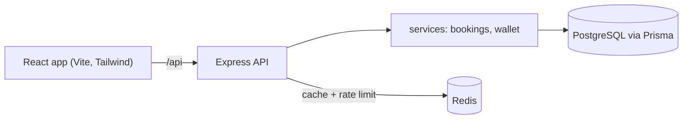
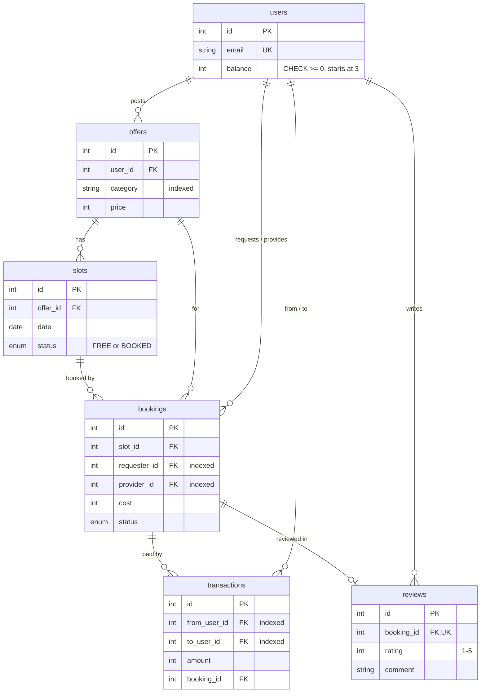

# TimeBank

A skill-swap web app for students. One hour of help given earns one credit, and credits are spent to receive someone else's help.

**Stack:** PostgreSQL + Prisma, Express, React (Vite) + Tailwind, Redis (caching and rate limiting), Jest + Supertest, Docker Compose.

## Screenshots

<!-- Add your own screenshots to docs/screenshots/ and link them here, for example:
 -->

_Screenshots to be added: Browse, Offer Detail, My Bookings, Wallet, Community Stats._

## Run it

### With Docker (everything)

```bash
docker compose up --build        # postgres, redis, api, web
docker compose exec api npm run seed   # load demo data (in a second terminal)
```

Open http://localhost:8080. Log in as `alice@demo.com` / `password123` (also bob, carol, dave, eve).

### For development

```bash
docker compose up -d postgres redis      # Postgres on :5433, Redis on :6379
cd server && cp .env.example .env
npm install
npx prisma migrate dev
npm run seed                             # optional demo data
npm run dev                              # API on http://localhost:4000
cd ../client && npm install && npm run dev   # web on http://localhost:5173
```

### Tests

```bash
cd server && npm test
```

Tests use a separate database (`timebank_test`) and Redis database 1, both from `server/.env.test`. They need `docker compose up -d postgres redis` first. A GitHub Actions workflow (`.github/workflows/test.yml`) runs them on every push.

## Architecture





Code layout: `server/src/routes` (HTTP), `server/src/services` (booking and credit logic), `server/src/middleware` (auth, validation, errors, rate limiting), `server/src/lib` (Prisma, Redis, cache helpers).

## How it works

### Credits

- Every user has a `balance` and starts with 3 credits.
- Credits move only when a booking is marked `COMPLETED` by the requester. Requesting or accepting a booking does not move anything.
- On completion, one `prisma.$transaction` does three things together: subtract from the requester, add to the provider, and insert a row in `transactions`. If any step fails, none of them happen, so balances and the transaction log cannot drift apart.
- The database enforces `CHECK (balance >= 0)`, so a balance can never go negative, even if application code has a bug. If completion would break it, the request fails with a 409 and nothing changes.
- When requesting, the app checks `balance - cost of my other REQUESTED/ACCEPTED bookings >= cost of this one`. This stops a user from promising more credits than they have, without needing a separate hold account.
- The wallet history is simply the `transactions` rows where the user is the sender or receiver.

### Slots

Each slot is `FREE` or `BOOKED`. To book, the API runs one `updateMany` with `where: { id, status: 'FREE' }`. If it updated 0 rows, someone else got there first and the API returns 409 "Slot already taken". Two simultaneous requests can never both succeed, because the database only lets one of them flip the row. Declining or cancelling sets the slot back to `FREE`.

### Bookings

```
REQUESTED -> ACCEPTED   (provider)
REQUESTED -> DECLINED   (provider)
REQUESTED / ACCEPTED -> CANCELLED   (requester or provider)
ACCEPTED -> COMPLETED   (requester, after the session)
```

All allowed changes live in one small table in `server/src/services/bookingRules.js`; anything else is rejected with a clear error. Status updates are also guarded (`updateMany ... where status = <old status>`), so completing a booking twice cannot pay twice.

### Reviews and stats

After a booking is `COMPLETED`, the requester can leave one rating (1-5) and a comment. Average ratings are shown on offers and profiles, and the Browse "minimum rating" filter uses them. The Community Stats endpoint (`GET /api/stats`) uses raw SQL (`JOIN` + `GROUP BY`) for hours exchanged, the top 5 skills, and the top 5 helpers.

### Caching (Redis)

- `GET /api/stats` is cached under `cache:stats` and `GET /api/offers` under `cache:browse:<query string>`, each for 60 seconds. The `X-Cache: HIT|MISS` response header shows what happened.
- The relevant keys are deleted whenever an offer or slot is created, changed or deleted, a booking is requested or changes status (stats only when it completes), or a review is added. Deletion uses `SCAN` with a key prefix, never `KEYS`.

### Rate limiting (Redis)

A small fixed-window middleware (`server/src/middleware/rateLimit.js`) uses `INCR` and `EXPIRE`: login is limited to 5 requests per minute per IP, and booking requests to 20 per minute per user. Going over the limit returns HTTP 429 with a `Retry-After` header.

### If Redis is down

The app keeps working. Every Redis call is wrapped in try/catch: cache reads fall back to the database, and the rate limiter lets requests through. (Checked by stopping the Redis container while using the API.)

## Benchmark: stats endpoint

`npm run benchmark` (in `server/`) temporarily adds 50,000 completed bookings, then times 200 requests to `GET /api/stats` with the cache emptied before each request, and 200 requests served from the cache. The data is removed afterwards.

| | average | p95 |
|---|---|---|
| Without cache | 39.55 ms | 43.31 ms |
| With cache | 1.20 ms | 1.82 ms |

About 33x faster with the cache. Numbers will differ on your machine.

## API summary

| Method | Path | Notes |
|---|---|---|
| POST | `/api/auth/signup`, `/api/auth/login` | login is rate limited |
| GET | `/api/auth/me` | auth |
| GET | `/api/users/:id` | public profile |
| GET | `/api/offers` | search, `category`, `maxPrice`, `minRating`; cached |
| GET | `/api/offers/mine`, `/api/offers/:id` | |
| POST/PUT/DELETE | `/api/offers`, `/api/offers/:id` | auth, owner only |
| POST/DELETE | `/api/offers/:id/slots`, `/api/offers/:id/slots/:slotId` | auth, owner only |
| GET/POST | `/api/bookings` | auth; `?role=requested\|received`; POST rate limited |
| PATCH | `/api/bookings/:id/status` | auth |
| GET | `/api/wallet` | auth |
| POST | `/api/reviews` | auth, requester of a completed booking |
| GET | `/api/stats` | cached |
